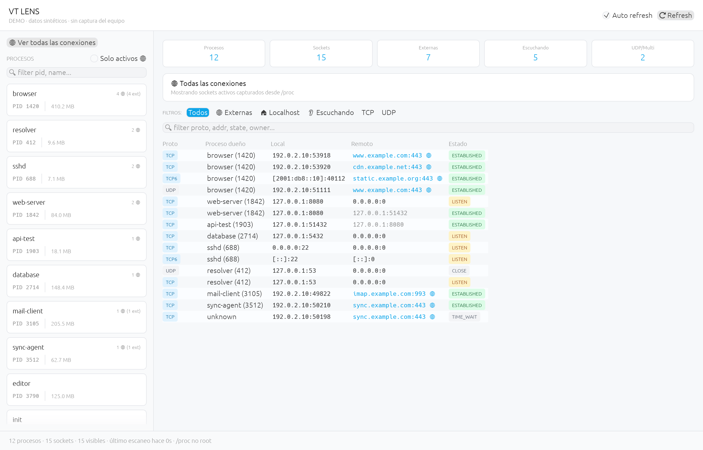
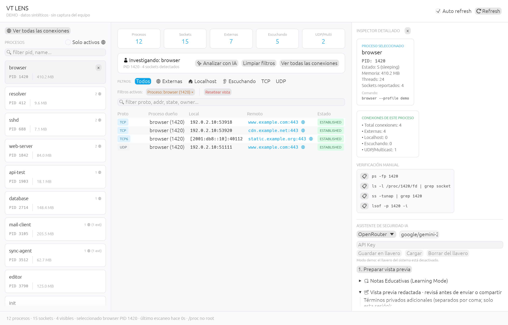
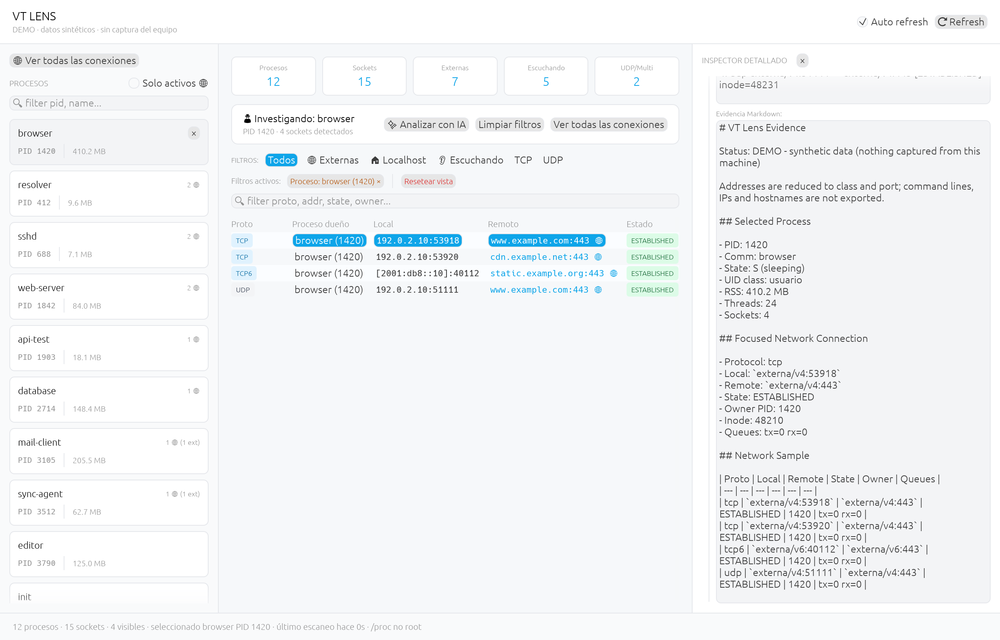

# VT Lens

> No podes defender sistemas que no entendes como funcionan.

VT Lens is a native Rust GUI that helps you understand what your computer is
doing: running processes, visible network connections, and an evidence workspace
that turns a selected slice into an LLM-ready prompt or Markdown export.

This is an educational instrument, not a packet sniffer or an EDR. It shows
process and connection metadata without requiring root access: on Linux it
reads the `/proc` process and connection tables; on macOS, which has no
`/proc`, it lists processes through libproc and sockets through `lsof`.



| Un proceso bajo la lupa | Evidencia redactada para un LLM |
| --- | --- |
|  |  |

Las capturas son del modo demo (`vt-lens --demo`): procesos inventados,
direcciones de los rangos de documentación (192.0.2.0/24, 198.51.100.0/24,
203.0.113.0/24, 2001:db8::/32) y nombres bajo example.com. Se generan sin
ventana con `cargo test --features screenshots screenshots` (ver
[Verify](#verificación-de-código-verify)).

## Instalación (Installation)

### 1. Dependencias del Sistema (solo para compilar)
Si instalas el binario precompilado (ver punto 2) no necesitas Rust ni estas dependencias. Para compilar la interfaz gráfica nativa con `egui/eframe` desde el código fuente, necesitas las dependencias de desarrollo correspondientes a tu sistema:

**macOS (Apple Silicon o Intel):** solo las Command Line Tools de Xcode y Rust ([rustup](https://rustup.rs)).
```bash
xcode-select --install
```

**Debian / Ubuntu / Mint / Pop!_OS:**
```bash
sudo apt-get install -y build-essential libxcb-render0-dev libxcb-shape0-dev libxcb-xfixes0-dev libxkbcommon-dev libssl-dev libgtk-3-dev
```

**Fedora / RHEL:**
```bash
sudo dnf install -y gcc-c++ libxcb-devel libxkbcommon-devel openssl-devel gtk3-devel
```

**Arch Linux / Manjaro:**
```bash
sudo pacman -S --needed base-devel libxcb xkbcommon openssl gtk3
```

---

### 2. Instalación Directa de una Línea (vía Curl)
Para instalar VT Lens (y en Linux, registrar su lanzador de escritorio) de manera automatizada, ejecuta:
```bash
curl -sSL https://raw.githubusercontent.com/ValentinTorassa/vt-lens/main/install.sh | bash
```
El script elige el binario precompilado de la última [release](https://github.com/ValentinTorassa/VT-Lens/releases) según `uname -s` / `uname -m`, verifica su SHA256 contra `SHA256SUMS` y aborta si no coincide. Hay binarios para:
- Linux x86_64 (glibc 2.35 o superior: Ubuntu 22.04+, Debian 12+).
- macOS 11 o superior, Apple Silicon (`aarch64-apple-darwin`) e Intel (`x86_64-apple-darwin`). En un Mac con Apple Silicon elige el binario nativo aunque la terminal corra bajo Rosetta.

Si no hay binario para tu sistema, clona y compila desde el código fuente (requiere Rust y las dependencias del punto 1).

En macOS, el binario no está firmado ni notarizado por Apple. Instalado con el script (`curl`) se ejecuta sin más; si bajaste el `.tar.gz` con el navegador, Gatekeeper lo bloquea la primera vez. Revisá que su SHA256 coincida con `SHA256SUMS` (`shasum -a 256 vt-lens-*.tar.gz`) y quitale la marca de cuarentena al binario extraído:
```bash
xattr -d com.apple.quarantine vt-lens-<versión>-aarch64-apple-darwin/vt-lens
```

Opciones (pásalas con `| bash -s -- <opciones>`):
- `--from-source`: compila desde el código fuente aunque exista un binario precompilado.
- `--prefix DIR`: instala en `DIR/bin` en lugar de `~/.local/bin`.
- `--dry-run`: muestra lo que haría sin instalar nada.

Cada release también publica los archivos `vt-lens-<versión>-<target>.tar.gz` para descargarlos a mano.

---

### 3. Instalación de Escritorio Manual (Lanzador y Menú)
Si ya tienes el repositorio clonado localmente, ejecuta el script de instalación (en Linux también registra el lanzador `vt-lens.desktop`; en macOS instala solo el binario):
1. Dale permisos de ejecución al script:
   ```bash
   chmod +x install.sh
   ```
2. Ejecuta el script:
   ```bash
   ./install.sh
   ```

Una vez completado, podrás buscar **"VT Lens"** en tu lanzador de aplicaciones de escritorio (Linux) o ejecutarlo con:
```bash
vt-lens
```

Para una captura pública sin exponer procesos, sockets o nombres del equipo,
ejecutá `vt-lens --demo`. La ventana muestra datos sintéticos y una etiqueta
visible de demo; el botón de refrescar conserva ese modo durante toda la sesión.

### macOS: qué cambia

macOS no tiene `/proc`, así que VT Lens lee los procesos con libproc (la misma
interfaz que usan `ps` y `top`) y los sockets TCP/UDP con `lsof -nP -iTCP -iUDP`.
Sin `sudo` hay dos límites, y la app los explica en las notas educativas y en
el prompt para el LLM:
- `lsof` solo ve los sockets de **tus** procesos. Los de root y de otros
  usuarios no aparecen (`netstat -anv` sí los lista, con `proceso:pid`).
- Los procesos de otros usuarios aparecen en la lista, pero sin memoria,
  threads ni argumentos (estado `?`).

Además, «sockets» cuenta solo sockets TCP/UDP (en Linux incluye también los
sockets Unix), cada socket se identifica por el file descriptor de su proceso
en lugar de un inode, y el llavero todavía no está integrado: la API key vale
solo para la sesión.

---

### 4. Instalación vía NPM (Global)
Si tienes Node.js configurado, puedes instalarlo de manera global ejecutando:
```bash
npm install -g ValentinTorassa/vt-lens
```
NPM compilará automáticamente el binario nativo en modo release y lo registrará en tu ruta de binarios globales.

---

### 5. Paquete Debian (`.deb`), opcional
Las releases publican los tarballs de Linux x86_64 y macOS (arm64 e Intel) y `SHA256SUMS`; no hay `.deb` precompilado. Si querés un paquete, generalo vos con [`cargo-deb`](https://github.com/kornelski/cargo-deb):
```bash
cargo install cargo-deb
cargo deb
sudo apt install ./target/debian/vt-lens_*.deb
```

---

### 6. Instalación Rápida con Cargo (Para Desarrolladores Rust)
Si tienes el entorno de desarrollo de Rust configurado y quieres compilar e instalar la app directamente en tu directorio binario de cargo:
```bash
cargo install --path .
```

---

## MVP Features

- Native minimal GUI with `egui` / `eframe` (0.36).
- Linux and macOS: both backends feed the same UI (`src/capture/`).
- Live process table: PID, name, command line, memory, threads, socket count.
- Live network table: protocol, owner process, local address, remote address,
  connection state, queue sizes, socket inode (Linux) or file descriptor
  (macOS).
- Process focus: click a process to filter its network activity.
- LLM analysis workspace: every analysis goes through a preview of the
  prompt built from the selected process/network slice; nothing is sent until
  you press **2. Enviar a IA**.
- Markdown evidence preview for labs, writeups, and videos, built from the
  same allowlist as the prompt.
- Antes/después: **1. Guardar antes** conserva la captura visible y
  **2. Capturar después** toma una nueva. La comparación queda fija aunque
  continúe el refresco: procesos y sockets nuevos, los que dejaron de verse
  y cambios de estado. **Copiar comparación redactada** usa la misma
  selección de campos y términos privados que la evidencia, sin enviarla a IA.
  Ambas capturas viven solo en memoria y se borran con **Limpiar** o al cerrar.
  No muestra actividad entre capturas ni demuestra que una desaparición sea
  un cierre. Si el sistema oculta el inicio de un proceso, un PID reutilizado
  puede resultar indistinguible.
  [Ejemplo con datos sintéticos](docs/screenshots/comparison.png).

---

## Ejecución en Desarrollo (Run)

Para probar la aplicación localmente en modo desarrollo:
```bash
cargo run
```

## Verificación de Código (Verify)

```bash
cargo fmt --check
cargo clippy --locked --all-targets -- -D warnings
cargo test --locked
cargo build --locked
```

GitHub Actions (`.github/workflows/ci.yml`) corre lo mismo en Linux (con las
dependencias gráficas de Debian/Ubuntu del punto 1) y en macOS, donde los tests
del backend leen el propio proceso del test y un socket que abre.

Las capturas del README se regeneran sin abrir ninguna ventana, renderizando
la app real con datos de demo (wgpu fuera de pantalla, vía `egui_kittest`):
```bash
cargo test --features screenshots screenshots   # escribe docs/screenshots/*.png
```

## Privacy And Safety

- The raw log is the evidence. An LLM explanation is only interpretation.
- Do not publish exports that contain real private hosts, internal services,
  tokens, customer data, employer data, or personal network details.
- The MVP does not capture packet payloads.
- The prompt evidence and the Markdown export are built from an allowlist of
  structured fields (`src/evidence.rs`): process basename, PID, memory and
  thread counts, UID class (root / sistema / usuario), protocol, socket state,
  inode, and each endpoint reduced to its class and port (`externa/v4:443`,
  `loopback/v6:631`). Command lines, IP addresses, hostnames and account names
  are never included, so they cannot leak through a pattern that failed to match.
- Control characters in `comm` and argv are replaced at capture time.
- Everything that leaves the app (including text you type into the editable
  preview) then goes through free-text redaction: credential names with `:` or
  `=` (`OPENAI_API_KEY=`, `GITHUB_TOKEN:`), secret flags (`--password X`),
  `user:pass@` in URLs, common key formats (`sk-`, `ghp_`, `github_pat_`,
  `AKIA`, `xox*-`, `AIza`, `glpat-`), long high-entropy tokens, email
  addresses, home paths and IPv4/IPv6 literals. The preview also accepts
  comma-separated private terms for this session; they are applied again
  immediately before a provider request. Review the preview before sending or
  sharing: pattern matching cannot recognize every kind of private data.
- Reverse DNS lookups (display only, never exported) tell your resolver which
  peers are on screen; demo mode does not perform them (its example.com names
  are part of the fixture).
- On macOS, `lsof` runs from its absolute path (`/usr/sbin/lsof`), so another
  `lsof` earlier in `$PATH` is never used.
- Provider keys are used for the request and are not written to logs. On Linux,
  `secret-tool` stores them in the desktop OS keyring when you click **Guardar en
  llavero**. VT Lens loads the selected provider's key at startup and when you
  switch providers. **Borrar del llavero** removes it. A locked or unavailable
  keyring leaves the field empty; you can still paste a key for this session.
  On macOS the keyring buttons are disabled for now (no `secret-tool`; the
  Keychain is not wired in yet), so a pasted key lasts for the session only.
  Demo mode never reads or writes the keyring (its buttons are disabled).
- The Anthropic provider defaults to `claude-opus-5-5` with the server-side
  fallback beta enabled; the model field stays editable.

## Roadmap

1. Persist private-term preferences locally without copying them to exports.
2. Add optional packet capture mode behind an explicit root/capability warning.
3. Add DNS/SNI/cert-chain enrichment for the network pane.
4. macOS: store provider keys in the Keychain.

## License

GPL-3.0-only: version 3 of the GNU GPL, without the "or any later version" option. Full text in
[LICENSE](LICENSE).
